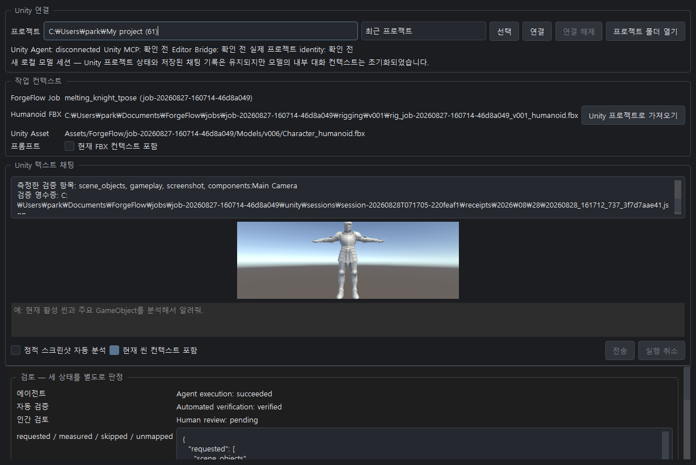
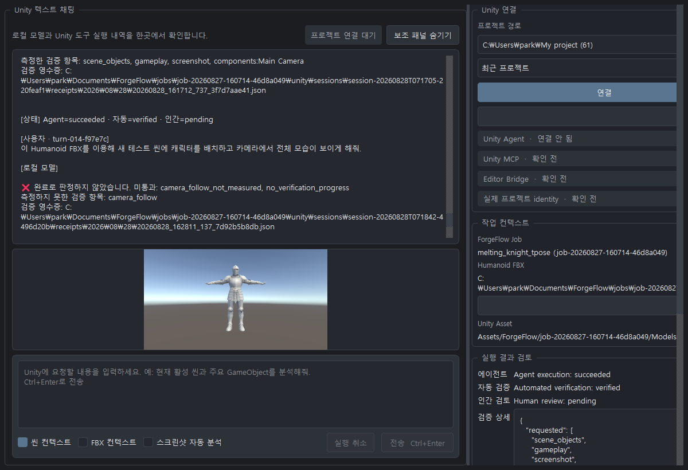

# 변경 이력

ForgeFlow의 사용자에게 영향을 주는 주요 변경 사항을 최신 버전부터 기록합니다.
변경 이력 관리는 `0.1.4`부터 시작하며 이전 버전의 변경 사항은 소급해 분류하지 않습니다.

## 2026-10-11

### 수정

- 손상된 설정 파일이나 잘못된 설정 값이 앱 시작을 막지 않도록 정상 백업 또는 기본값으로 복구합니다. 올바른 기존 설정은 유지하고 복구 안내와 설정 확인 버튼을 표시합니다.
- 설정 저장 시 이전 정상 설정은 `config.json.bak`, 손상된 원본은 고유한 `config.json.corrupt-<ID>.bak`로 보존합니다. 백업이나 저장에 실패하면 기존 설정 파일은 유지됩니다.
- Blender 계획 생성과 실행의 취소·시작 실패·재시작 시 요청 이력에 실행 중 상태가 남지 않도록 수정했습니다. 계획 중단은 이전 완료 결과와 승인 대기 계획을 보존합니다.
- Blender 실행 준비 실패 후 재시도를 막던 빈 버전 폴더 문제를 수정했습니다. 기존 중단 폴더는 보존하고 다음 버전을 사용하며, 로그 준비 실패도 요청을 실패로 종결합니다.
- 리깅 실행 전에 등록된 GLB의 SHA-256을 확인하고, 내용이 바뀐 입력은 출력 폴더 생성 전에 차단합니다. 등록 해시가 없는 이전 작업은 현재 파일을 새 실행의 기준으로 사용하며 입력 목록과 기존 최종 확인창에 안내합니다.

### 검증

- 설정 복구·백업 실패·동시 저장, Blender 중단·재시작·재시도, 리깅 입력 변경과 기존 데이터 호환에 대한 회귀 테스트를 추가했습니다.
- Windows 프로세스 취소 테스트는 보관된 프로세스 핸들의 실제 종료를 확인하고 관련 없는 프로세스가 유지되는지 검사합니다.

## [0.1.4] - 2026-08-31

### Unity UI 비교 — Melting Knight

동일한 `melting_knight_tpose` 작업 데이터를 표시한 상태에서 비교했습니다.

| 이전 UI | → | 현재 UI |
|---|:---:|---|
|  | → |  |

### 추가

- 환경 연결 상태에 `Unity MCP` 항목을 추가하고 Unity Editor Bridge에 실제 `ping` 요청을 보내 연결 여부를 확인하도록 했습니다.
- Unity 텍스트 채팅에서 `Ctrl+Enter` 전송 단축키를 지원합니다.
- 채팅에 집중할 수 있도록 `보조 패널 숨기기/보기` 기능을 추가했습니다.

### 변경

- `4. Unity 텍스트 컨트롤` 화면을 채팅 중심의 2열 레이아웃으로 전면 개편했습니다.
- 채팅 영역이 화면 대부분을 사용하도록 확대하고 입력 영역을 채팅 하단에 고정했습니다.
- 프로젝트 연결, 작업 컨텍스트, 실행 결과 검토를 우측의 독립 스크롤 패널로 이동했습니다.
- 연결 상태를 단계별 상태 색상과 간결한 문구로 구분하고 주요 동작 버튼의 시각적 우선순위를 정리했습니다.
- 실행 결과 버튼을 2열로 재배치하고 긴 경로와 검토 정보가 좁은 화면에서도 읽히도록 줄바꿈을 개선했습니다.
- Unity 결과 스크린샷은 실제 이미지가 있을 때만 표시하여 평상시 채팅 공간을 확보했습니다.

### 배포

- 현재 애플리케이션 버전을 `0.1.4`로 지정했습니다.
- 패키지 버전의 단일 기준을 `forgeflow.__version__`으로 설정하고 프로젝트 메타데이터와 앱 표시 버전이 이를 사용하도록 정리했습니다.
